# MemoryAPI JSFX Suite

A cross-platform collection of 16 studio mixing, mastering, and synthesis JSFX plugins for [Cockos REAPER](https://www.reaper.fm/), featuring custom hardware-accelerated vector UIs styled in the **Catppuccin Mocha** palette.

## Installation (ReaPack)

1. In REAPER, navigate to **Extensions → ReaPack → Import repositories...**
2. Paste the repository index URL and click **OK**:
   ```text
   https://raw.githubusercontent.com/memoryapi/memoryapi-jsfx/master/index.xml
   ```
3. Open **Extensions → ReaPack → Browse packages...**, search for `memoryapi` (or any plugin below), right-click to **Install**, and click **Apply**.

---

## Suite Architecture

Every plugin in this repository shares a unified design standard:
* **Cross-Platform & Native:** Runs with zero external dependencies on Linux, Windows, and macOS.
* **Linux X11 / HiDPI Scaling:** Built-in `100% / 125% / 150%` UI scale toggles and responsive window geometry for crisp typography on unscaled X11 and Wayland displays.
* **Click-Free Transport & Automation:** Full parameter exposure to REAPER automation lanes with `ext_noinit` state preservation and Cytomic Zero-Delay Feedback (ZDF) / State Variable Filter (SVF) topologies.

---

## Plugin Index

| Category | Plugin | Description |
| :--- | :--- | :--- |
| **Dynamics** | [**SpectralCarver**](#dynamics) | 32-band sidechain dynamic spectral ducker |
| **Dynamics** | [**Opto2A**](#dynamics) | Program-dependent T4 optical tube compressor |
| **Dynamics** | [**OverTop**](#dynamics) | 3-band upward & downward multiband compressor |
| **Dynamics** | [**PulseDuck**](#dynamics) | Multiband rhythmic sidechain & envelope shaper |
| **Dynamics** | [**VelvetClip**](#dynamics) | Threshold-linear master soft clipper with 808 sub protection |
| **EQ** | [**ConsoleQ**](#equalizers) | 4-band E/G British console strip with Air Band & FFT analyzer |
| **EQ** | [**PocketQ**](#equalizers) | Compact zero-FFT fixed-band console & Air equalizer |
| **EQ** | [**ReEQ Studio**](#equalizers) | 16-band parametric equalizer with piano roll & spectrum grab |
| **Saturation** | [**OInflator**](#saturation) | Polynomial harmonic waveshaper & 3-band loudness enhancer |
| **Saturation** | [**Phoenix**](#saturation) | 5-mode analog tape saturator with selectable flux curves |
| **Time & Space** | [**EchoForge**](#time--space) | Tape varispeed, Lo-Fi & diffused ping-pong delay |
| **Time & Space** | [**AetherVerb**](#time--space) | 8-mode algorithmic, shimmer, formant & FDN reverberator |
| **Creative FX** | [**ChronoWarp**](#creative--synthesis) | Tempo-synced half-time, varispeed & octave-shimmer engine |
| **Creative FX** | [**RhythmForge**](#creative--synthesis) | 6-module polyrhythmic multi-effect & envelope shaper workstation |
| **Creative FX** | [**VintageFlux**](#creative--synthesis) | 6-module retro multi-FX & lo-fi texture processor |
| **Synthesis** | [**AetherSynth**](#creative--synthesis) | 8-voice polyphonic unison supersaw & ZDF analog synthesizer |

---

## Dynamics

<table>
  <tr>
    <td width="50%" valign="top">
      <h3 align="center">SpectralCarver</h3>
      <p align="center">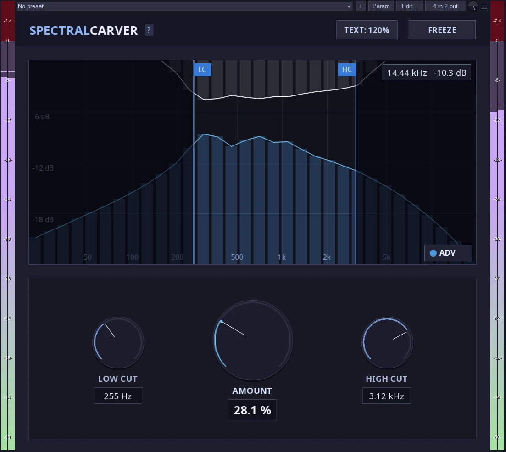</p>
      <p><b>32-Band Dynamic Spectral Ducker</b> — Carves out only the exact frequencies present in the sidechain (Ch 3/4), preserving mix fullness without broadband pumping.</p>
      <ul>
        <li>32-band Cytomic SVF filterbank with draggable Low/High-Cut curtains.</li>
        <li>Stereo (L/R) and Mid/Side processing with continuous balance weighting.</li>
        <li><b>Freeze</b> static EQ capture and <b>Sidechain Audition</b> mode.</li>
      </ul>
    </td>
    <td width="50%" valign="top">
      <h3 align="center">Opto2A</h3>
      <p align="center">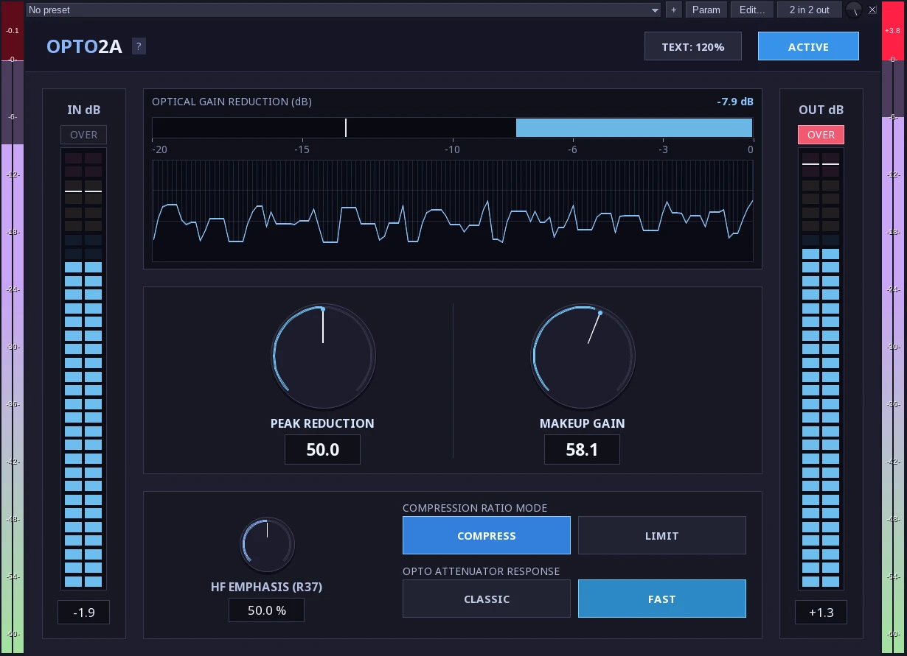</p>
      <p><b>Optical Tube Compressor</b> — Program-dependent optical leveling with two-stage release memory and tube stage saturation.</p>
      <ul>
        <li>Switchable <b>Compress / Limit</b> ratios and <b>Classic / Fast</b> opto cell speeds.</li>
        <li><b>HF Emphasis (R37)</b> sidechain control for frequency-sensitive vocal leveling.</li>
        <li>Scrolling gain reduction history trace and native REAPER mixer GR reporting.</li>
      </ul>
    </td>
  </tr>
  <tr>
    <td width="50%" valign="top">
      <h3 align="center">OverTop</h3>
      <p align="center">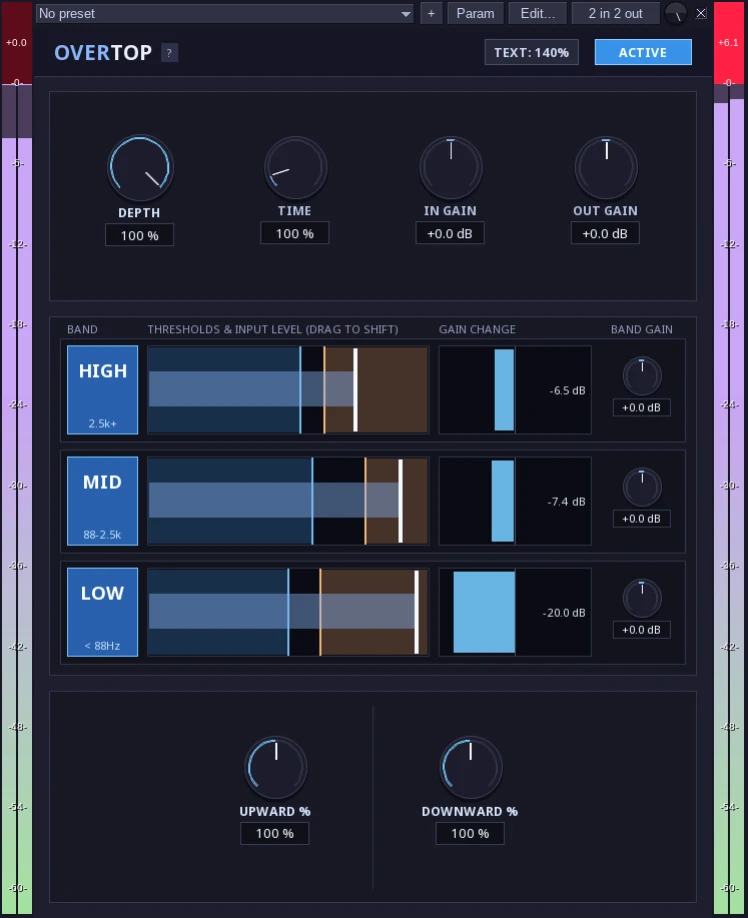</p>
      <p><b>3-Band Upward/Downward Compressor</b> — Authentic OTT-style multiband dynamics processor combining upward expansion of quiet details with downward peak control across Low (&lt;88 Hz), Mid, and High (&gt;2.5 kHz) bands.</p>
      <ul>
        <li>Phase-aligned 4th-Order Linkwitz-Riley (LR4, 24 dB/oct) crossover with true stereo RMS power detection.</li>
        <li>Authentic OTT time constants (0.15x Attack / 0.25x Release multipliers), +10.3 dB High makeup lift, and phase-coherent Depth scaling.</li>
        <li>Inline channel strips with draggable per-band thresholds, gain knobs, bypasses, and global Upward/Downward % scalers.</li>
      </ul>
    </td>
    <td width="50%" valign="top">
      <h3 align="center">PulseDuck</h3>
      <p align="center">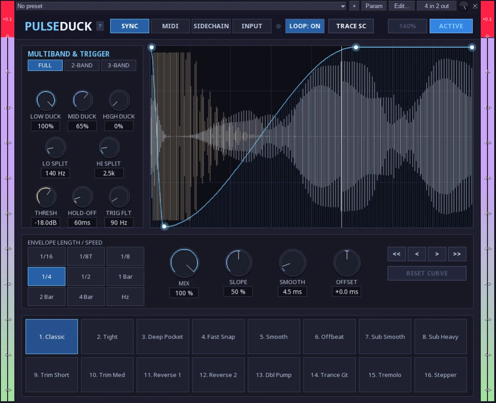</p>
      <p><b>Multiband Sidechain &amp; Envelope Shaper</b> — Precision volume shaping with dual-waveform kick/bass alignment and custom node editing.</p>
      <ul>
        <li>16 curve presets + custom breakpoint editor with <b>Slope</b> skew and phase <b>Shift</b>.</li>
        <li>4 trigger modes: <b>Sync</b>, <b>MIDI</b>, <b>Sidechain (Ch 3/4)</b>, and <b>Self-Input</b>.</li>
        <li><b>Trace SC</b> auto-shapes the ducking curve around your incoming kick drum.</li>
        <li>Full, 2-Band, or 3-Band Linkwitz-Riley crossover with independent band depth.</li>
      </ul>
    </td>
  </tr>
  <tr>
    <td colspan="2" valign="top">
      <h3 align="center">VelvetClip</h3>
      <p align="center">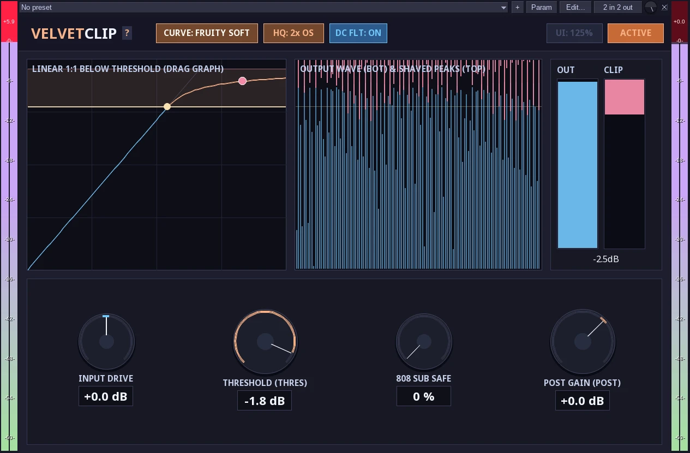</p>
      <p><b>Transparent Master Soft Clipper</b> — Strictly <code>1:1</code> bit-identical below the threshold (zero harmonic coloration on your mix) with smooth C¹-continuous transient rounding above the knee.</p>
      <ul>
        <li>3 clipping topologies: <b>Fruity Soft</b> (asymptotic), <b>Cubic Knee</b>, and <b>Bass Shaper</b>.</li>
        <li><b>808 Sub Safe</b> pre-deemphasis / post-reemphasis filter prevents low-end buzz on heavy sub-bass.</li>
        <li><b>2x Polyphase Oversampling</b>, interactive threshold graph, and dual waveform / shaved-peak history monitor.</li>
      </ul>
    </td>
  </tr>
</table>

---

## Equalizers

<table>
  <tr>
    <td width="50%" valign="top">
      <h3 align="center">ConsoleQ</h3>
      <p align="center">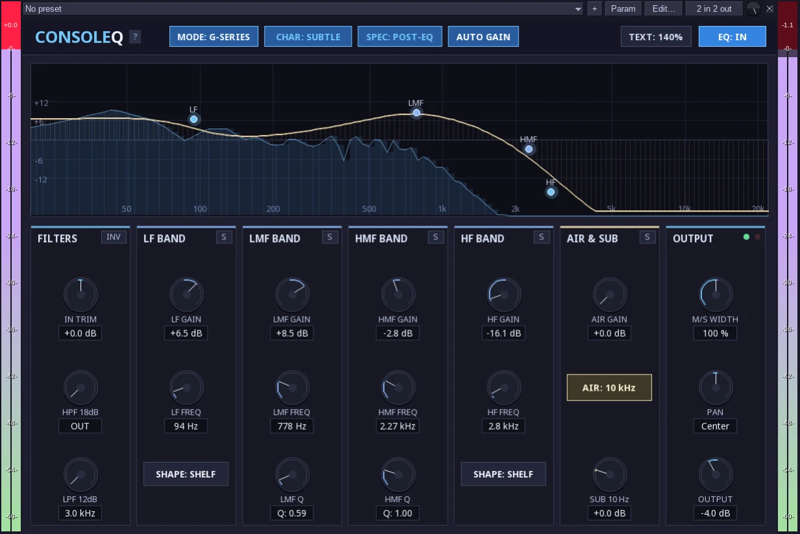</p>
      <p><b>Hybrid Console EQ &amp; Air Strip</b> — Combines a 4-band British console equalizer with a high-headroom 500-series Air Band and real-time 2048-point FFT analyzer.</p>
      <ul>
        <li>Switchable <b>E-Series</b> (constant Q) and <b>G-Series</b> (proportional Q) curves.</li>
        <li><b>Air Band</b> shelf (2.5k, 5k, 10k, 20k, 40 kHz) + <b>Sub 10 Hz</b> resonant weight bell.</li>
        <li>Draggable graph nodes, momentary <b>Band Solo [S]</b>, console saturation (Clean/Subtle/Warm), and Auto-Gain.</li>
      </ul>
    </td>
    <td width="50%" valign="top">
      <h3 align="center">PocketQ</h3>
      <p align="center">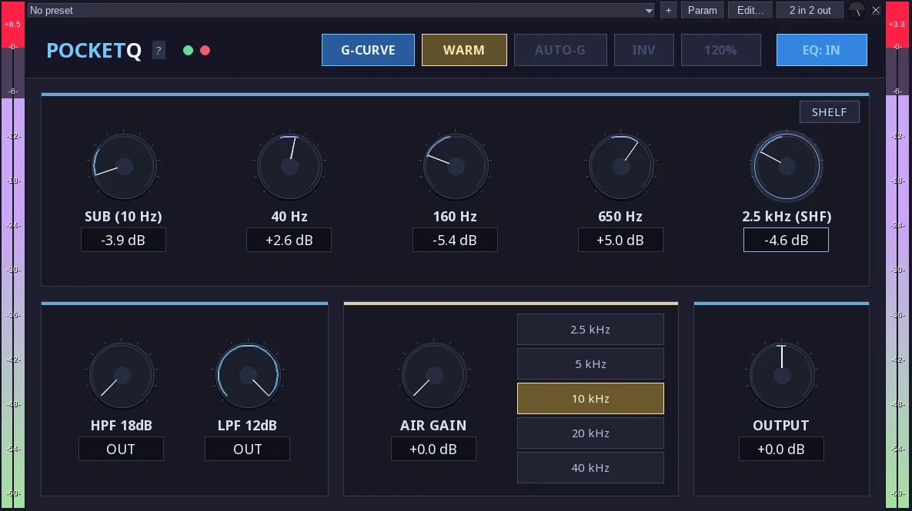</p>
      <p><b>Compact Console &amp; Air EQ</b> — Zero-FFT, ultra-low-CPU tactile equalizer designed for fast mixing across every track in a session.</p>
      <ul>
        <li>Fixed musical center frequencies: <b>Sub (10 Hz)</b>, <b>40 Hz</b>, <b>160 Hz</b>, <b>650 Hz</b>, and <b>2.5 kHz</b> (Shelf/Bell).</li>
        <li>5-frequency push-button <b>Air Band</b> (2.5k–40 kHz) plus 18 dB HPF and 12 dB LPF.</li>
        <li>Switchable E/G curves, Warm console drive, Auto-Gain, and Phase Invert.</li>
      </ul>
    </td>
  </tr>
  <tr>
    <td colspan="2" valign="top">
      <h3 align="center">ReEQ Studio</h3>
      <p align="center">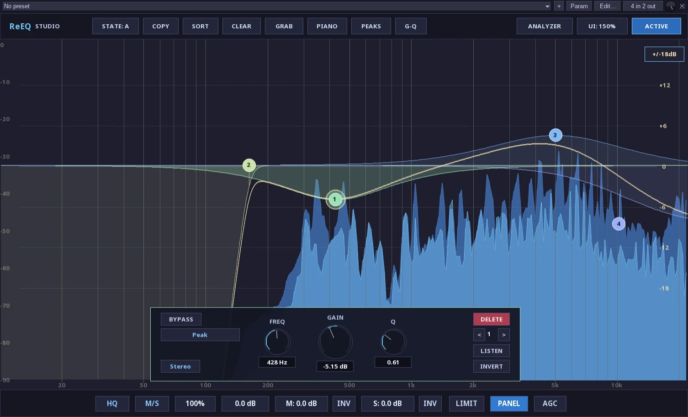</p>
      <p><b>16-Band Parametric Equalizer</b> — Studio workflow and Catppuccin UI upgrade of Justin Johnson's ReEQ with context-aware band previews and quick surgical tools.</p>
      <ul>
        <li>14 filter shapes per band (Peak, Butterworth/Analog Cuts, Shelves, Notch, Bandpass, Tilt, Pultec Low Shelf, All-Pass).</li>
        <li>Per-band <b>Stereo / Mid / Side / Left / Right</b> placement and 2x FIR oversampling.</li>
        <li><b>A/B State Compare</b>, <b>Spectrum Grab</b> peak detector, 88-key <b>Piano Roll</b> pitch quantizer, and node-tracking inspector.</li>
      </ul>
    </td>
  </tr>
</table>

---

## Saturation

<table>
  <tr>
    <td width="50%" valign="top">
      <h3 align="center">OInflator</h3>
      <p align="center">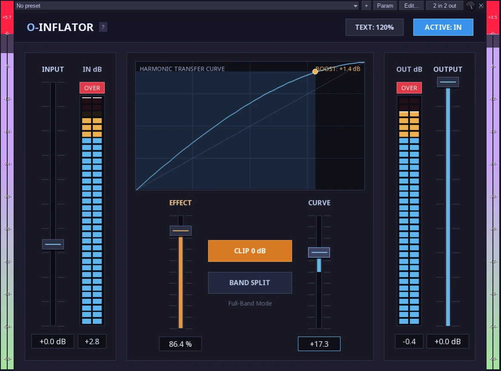</p>
      <p><b>Harmonic Waveshaper &amp; Loudness Enhancer</b> — Increases perceived loudness, density, and presence without squashing dynamic range.</p>
      <ul>
        <li>Polynomial harmonic transfer curve with live operating-point visualizer and dB boost readout.</li>
        <li>Phase-compensated <b>3-Band Split</b> (240 Hz / 2.4 kHz crossovers) and <b>Clip 0 dB</b> ceiling mode.</li>
      </ul>
    </td>
    <td width="50%" valign="top">
      <h3 align="center">Phoenix</h3>
      <p align="center">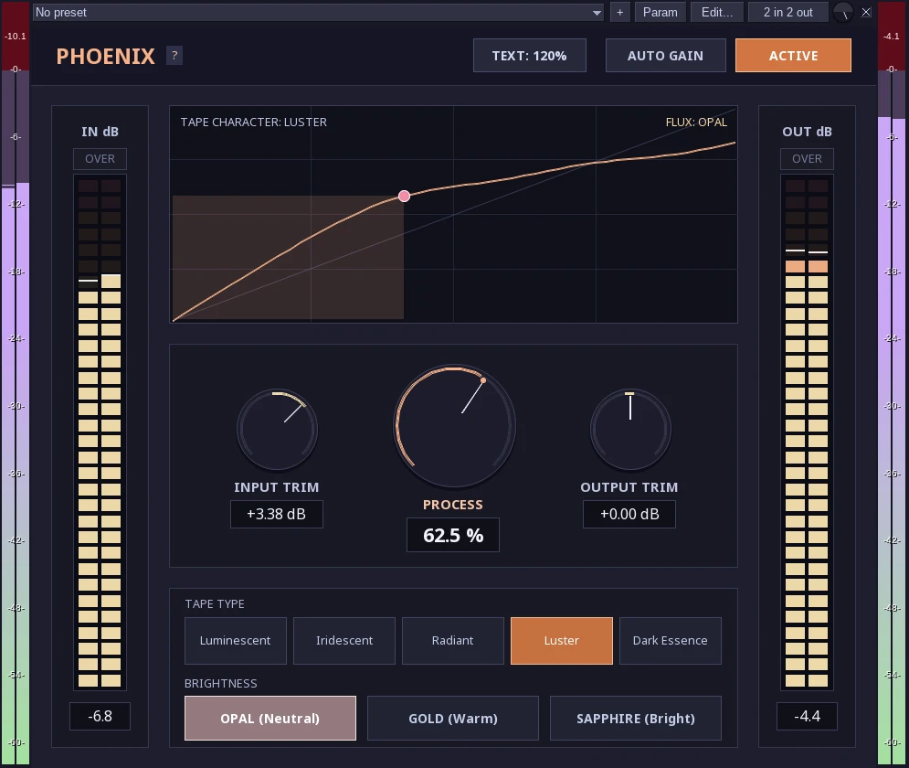</p>
      <p><b>Analog Tape Saturator</b> — Emulates magnetic tape compression, harmonic warmth, and high-frequency head saturation.</p>
      <ul>
        <li>5 tape topologies: <b>Luminescent</b>, <b>Iridescent</b>, <b>Radiant</b>, <b>Luster</b>, and <b>Dark Essence</b>.</li>
        <li>3 high-frequency flux curves (<b>Opal</b>, <b>Gold</b>, <b>Sapphire</b>) with switchable <b>Auto-Gain</b>.</li>
      </ul>
    </td>
  </tr>
</table>

---

## Time & Space

<table>
  <tr>
    <td width="50%" valign="top">
      <h3 align="center">EchoForge</h3>
      <p align="center">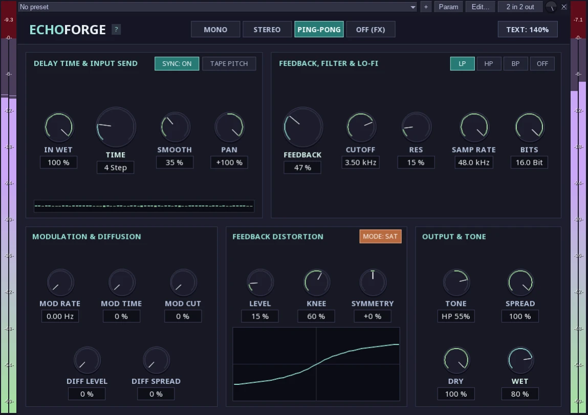</p>
      <p><b>Analog Tape, Lo-Fi &amp; Diffused Delay</b> — Versatile echo processor capable of clean ping-pong delays, dub self-oscillation, and ambient diffused washes.</p>
      <ul>
        <li>4 modes: <b>Mono</b>, <b>Stereo</b>, <b>Ping-Pong</b>, and <b>Off (Standalone Filter/Lo-Fi/Diffuser FX)</b>.</li>
        <li><b>Tape Pitch</b> (Doppler varispeed glide) vs. <b>Keep Pitch</b> (clickless crossfade).</li>
        <li>Feedback up to <b>150%</b> with resonant LP/HP/BP filter, asymmetric waveshaper, sample-rate/bit decimator, and 4-stage stereo All-Pass Diffuser.</li>
      </ul>
    </td>
    <td width="50%" valign="top">
      <h3 align="center">AetherVerb</h3>
      <p align="center">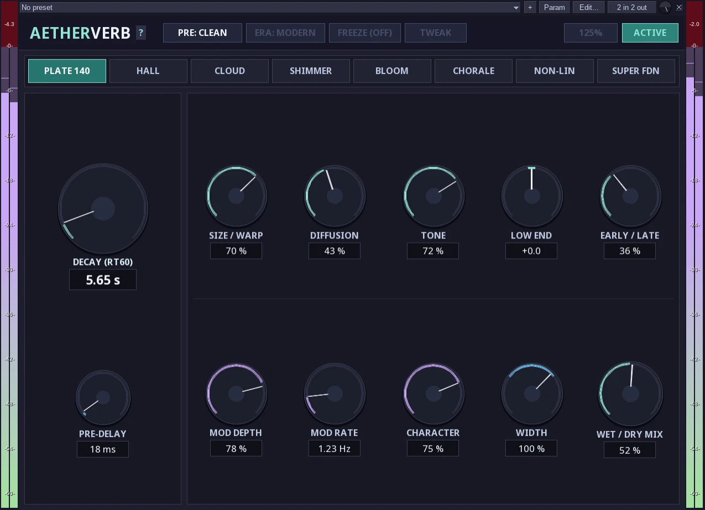</p>
      <p><b>8-Mode Algorithmic, Shimmer &amp; FDN Reverb</b> — Spans vintage studio plates to massive modulated feedback delay networks.</p>
      <ul>
        <li>8 machines: <b>Plate 140</b>, <b>Hall</b>, <b>Cloud</b>, <b>Shimmer</b>, <b>Bloom</b>, <b>Chorale</b>, <b>Non-Linear</b>, and <b>SuperFDN</b>.</li>
        <li>Dual pitch-shimmer voices (<code>-1 Oct</code> to <code>+2 Oct</code>) and morphing <code>AH/OH/OO</code> formant choir filters.</li>
        <li><b>Auto-Decay</b> dynamic tail ducking, <b>Tube V54 / Solid 162</b> input preamps, <b>70s 12-Bit / 80s Dark</b> converter eras, <b>Freeze/Infinite Hold</b>, and interactive Post-EQ.</li>
      </ul>
    </td>
  </tr>
</table>

---

## Creative & Synthesis

<table>
  <tr>
    <td width="50%" valign="top">
      <h3 align="center">ChronoWarp</h3>
      <p align="center">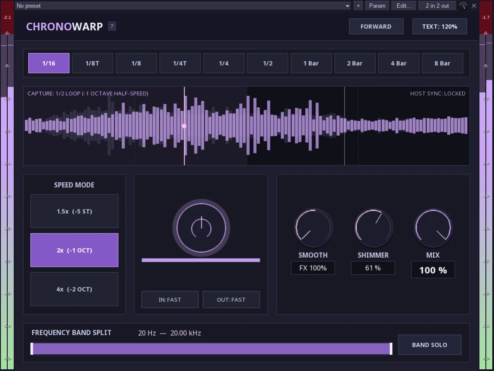</p>
      <p><b>Creative Half-Time &amp; Varispeed Engine</b> — Transforms melodies and drum loops via tempo-synced varispeed slicing and octave-up granular shimmer.</p>
      <ul>
        <li>3 speeds: <b>1.5x</b> (-5 st triplet groove), <b>2x</b> (-1 oct half-time), and <b>4x</b> (-2 oct quad-slow) across <code>1/16</code> to <code>8 Bar</code> loops.</li>
        <li>Bipolar <b>Smooth</b> knob (Sustain/Swell crossfade vs. Percussive transient preservation).</li>
        <li><b>Reverse</b> playback, <b>Octave Shimmer</b> grain layer, tempo-synced <b>Fade In/Out</b>, and 3-band crossover split with <b>Band Solo</b>.</li>
      </ul>
    </td>
    <td width="50%" valign="top">
      <h3 align="center">VintageFlux</h3>
      <p align="center">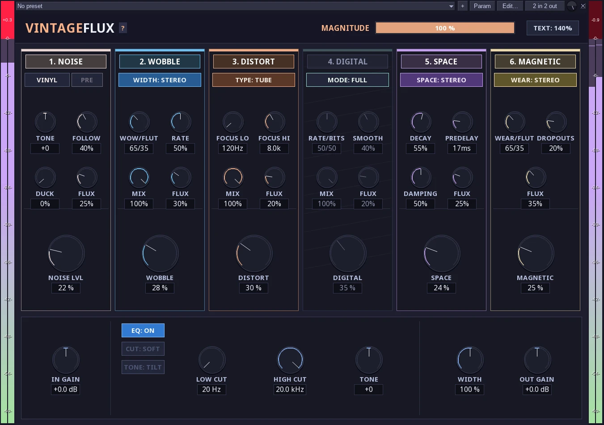</p>
      <p><b>6-Module Vintage Multi-FX &amp; Lo-Fi Workstation</b> — Combines six analog and early-digital degradation stages controlled by a single global <b>Magnitude</b> slider.</p>
      <ul>
        <li><b>Noise</b> (Vinyl/Cassette/VHS/White + Follow/Duck) → <b>Wobble</b> (Wow/Flutter) → <b>Distort</b> (Tube/Tape/Crunch/Fold) → <b>Digital</b> (Rate/Bits + Smooth) → <b>Space</b> (Reverb) → <b>Magnetic</b> (Wear/Dropouts).</li>
        <li>Per-module <b>Flux</b> organic random drift generators plus Master Cut &amp; Tilt/Smile Tone EQ.</li>
      </ul>
    </td>
  </tr>
  <tr>
    <td colspan="2" valign="top">
      <h3 align="center">RhythmForge</h3>
      <p align="center">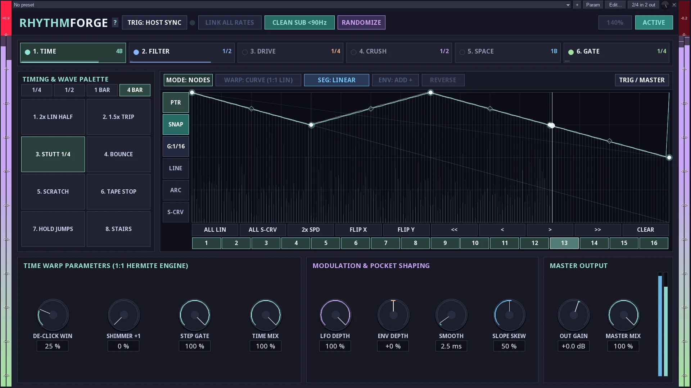</p>
      <p><b>6-Module Polyrhythmic Multi-Effect &amp; Envelope Shaper Workstation</b> — Combines six synchronized modulation engines (Time Warp, ZDF Filter, Drive Fold, Lo-Fi Crush, Comb Space, and Gate &amp; Haas) with custom multi-segment breakpoint envelopes, tension handles, and ShaperBox-style toolbars.</p>
      <ul>
        <li><b>6 FX Engines:</b> <b>Time Warp</b> (1:1 Hermite varispeed buffer with Half-Time, Stutter, Scratch &amp; Tape Stop), <b>ZDF Filter</b> (Ladder, MS Screamer, SVF), <b>Drive Fold</b> (Tube saturation &amp; wavefolding), <b>Lo-Fi Crush</b> (Bit depth &amp; sample rate decimation), <b>Comb Space</b> (Resonant tuned comb delay &amp; Haas widener), and <b>Gate &amp; Haas</b> (Trance gate, Haas delay, autopan).</li>
        <li><b>Vector LFO &amp; Curve Editor:</b> 6 per-segment curve types (Linear, Arc, S-Curve, Hold Step, Stairs, Sine Wave) with draggable midpoint tension diamonds, snap-to-grid, and pen tools.</li>
        <li><b>Polyrhythmic Modulation:</b> Independent per-module loop lengths (<code>1/16</code> to <code>4 Bars</code>), 16-step sequencer enable lane, host tempo sync, free Hz, MIDI note trigger (C2), or audio transient envelope follower.</li>
        <li><b>Clean Sub &amp; Master Finisher:</b> Linkwitz-Riley low-end crossover (&lt;90 Hz sub protection) with Bass Solo, Master Squash compressor, and output soft clipper.</li>
      </ul>
    </td>
  </tr>
  <tr>
    <td colspan="2" valign="top">
      <h3 align="center">AetherSynth</h3>
      <p align="center">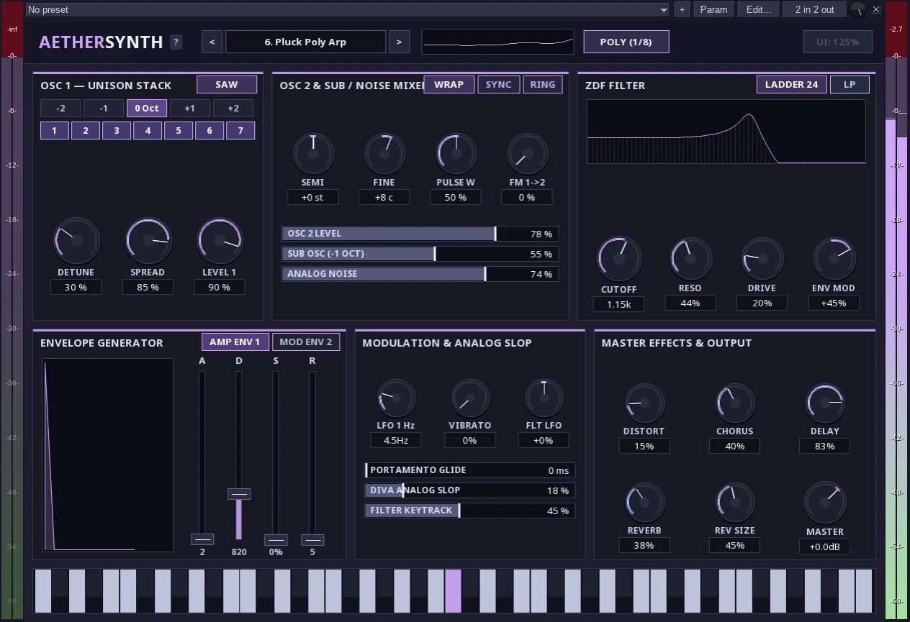</p>
      <p><b>8-Voice Polyphonic Unison &amp; ZDF Analog Synthesizer</b> — Pairs a 7-voice stereo unison supersaw oscillator stack with three Zero-Delay Feedback analog filter topologies.</p>
      <ul>
        <li><b>Osc 1 &amp; Osc 2:</b> PolyBLEP Saw, Pulse, Triangle, Sine, and TriWrap waves with 7-voice stereo unison, Hard Sync (<code>1-&gt;2</code>), linear FM, Ring Mod, Sub-Oscillator, and Analog Noise.</li>
        <li><b>3 ZDF Filters:</b> <b>Ladder 24dB</b>, <b>Bite MS Screamer</b>, and <b>Uhbie 12dB</b> (LP/BP/HP) with Drive, Keytrack, and live frequency response display.</li>
        <li><b>Modulation &amp; FX:</b> Tabbed Amp/Mod ADSR faders, 2 multi-wave LFOs, per-voice <b>Analog Slop</b>, 4-module Master FX rack (Distortion, Chorus, Ping-Pong Delay, Reverb), and 8 built-in factory patches.</li>
      </ul>
    </td>
  </tr>
</table>

---

## Credits

* **Opto2A**, **OInflator**, and **Phoenix** core DSP algorithms adapted from [JClones/JSFXClones](https://github.com/JClones/JSFXClones) (MIT License).
* **ReEQ Studio** core DSP and spectrum engine adapted from [Justin Johnson's ReJJ](https://github.com/Justin-Johnson/ReJJ) (MIT License).
